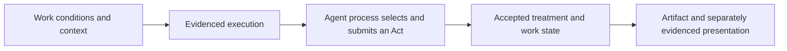

# Evidence for Agent participation and its consequence

Research date: 2026-10-17. Status: source-based findings and candidate protocol
implications. No implementation or live trial. Existing architecture and v0.1
drafts are not amended or promoted by these findings.

## Finding

There are usable mechanisms for evidencing actual inference, detecting changes
to contributions, checking history consistency and verifying the application
of a contribution to a work. They prove different claims under different trust
assumptions. A signed and logged client message alone does not establish that
an Agent generated it. A verified inference alone does not establish that its
output affected the artwork.

The defensible target is a connected chain of evidence: declared conditions and
authority, independently evidenced execution, exact attributable contribution,
accepted treatment, and the resulting work state or artifact. Each link needs
its own verification and explicit trust boundary. This chain is our synthesis,
not an existing standard or a qualified implementation.

The technical claim examined here is that a specified Agent execution
contributed an expression or decision that received the declared treatment
within a Work. For the current language-model examples, inference is one
component of that execution. This is not a replacement definition of Agent
Art or intention. Artistic interpretation remains with artists and participants;
the technical question is whether observable participation and its treatment
can be checked.

These are evidence dependencies, not mandatory creative stages or turn order.
Each link binds exact subjects and names who vouches for it. Agent origin and
arbitrary rounds remain possible.

## Claims and adversaries

The relevant adversaries are outsiders, a curator controlling their client,
an artwork artist/operator controlling the service, a dishonest execution
provider, and collusion among them. Protection against one does not imply
protection against the others. The following claims remain separate:

| Claim | Evidence needed | Remaining boundary |
| --- | --- | --- |
| A permitted principal submitted these bytes | Authenticated authority, independently rooted enrollment/key binding, complete signed submission and acceptance | A human controlling the client/key can still submit invented Agent output |
| A specified execution produced the contribution | Independently observed/attested execution or verified computation, bound to exact input/output and this encounter | Provider, witness, hardware or proof-system assumptions; scope of the covered execution |
| The evidenced Agent process selected and submitted this Act | Covered process/control policy, response-to-Act extraction, interventions and submission binding | A genuine model response selected or altered by a host is not thereby an Agent process's submission |
| The contribution was preserved faithfully | Retained original bytes, typed commitments/signatures and attributable transformations | Key compromise, missing content, exclusions from signature coverage and events outside the recorder |
| Retained history has not been rewritten or split | Inclusion/consistency proofs, independently retained checkpoints and an effective witness/comparison policy | Witness independence, availability, comparison and events never committed |
| The contribution received the declared treatment | Bound rules, input state, contribution, operation/outcome and output state/artifact; independent checking | Correct rule specification, authentic starting state, complete external inputs and actual presentation |

These are an evidence vector, not a single genuineness score. For example,
an artifact can be reproducibly derived from a contribution whose Agent origin
remains unverified. Conversely, a contribution with strong execution evidence
can be silently ignored by an artwork unless consequence is checked separately.

## What establishes execution origin

### Credentials and ordinary transcripts

MCP authorization specifies access to restricted servers on behalf of resource
owners. It supplies a permission boundary, not a model-generation attestation.
The pinned 2026-07-28 sampling specification also permits clients to change or
ignore requested system prompts/context; its sampling feature is deprecated.
An authenticated MCP call or sampling response cannot therefore certify an
untouched model context or Agent origin.
[MCP authorization](https://modelcontextprotocol.io/specification/2026-07-28/basic/authorization),
[MCP sampling](https://modelcontextprotocol.io/specification/2026-07-28/client/sampling).

An important inference follows: if a curator controls the client, outgoing
messages, recorder and signing key, the receiver cannot distinguish a genuine
Agent run from a script or manual submission producing the same messages.
Fresh challenges alone do not solve this: a script can sign a fresh reply.
Some trustworthy origin observation or computation proof must extend beyond
that adversary's unilateral control.

Statistical detection is a different kind of evidence. Original research
documents paraphrasing and spoofing limits for studied AI-text detectors;
watermarking research offers scheme-specific statistical signals. Even such
a signal does not bind an output to this Work, authorized Agent process or
consequence. That last point is our inference, not a claim that every detector
or watermark has identical weaknesses.
[Detection research](https://arxiv.org/abs/2303.11156),
[LLM watermarking research](https://arxiv.org/abs/2301.10226).

### Signed inference receipts

A provider can sign an input/output binding. Verification then establishes
what that provider endorsed, with trust in its operation and signing boundary.
The receipt must cover the returned contribution, not merely a request ID or
a declared model name. A signature on gateway traffic is narrower than a
signature tied to model execution.

NEAR AI documents model-serving `provider_tee` signatures binding a canonical
model ID and exact request/response hashes, versus gateway signatures binding
only request/response hashes. It explicitly warns that same-model instances
share signing keys and that its preflight evidence plus one signature is not
a complete model-to-gateway-to-final-response chain. This is a concrete
documented mechanism with material limits, not a qualified path for our project.
[NEAR response signatures](https://docs.near.ai/cloud/verification/cloud-api/response-signatures).

Its model verification procedure additionally requires quote verification,
nonce/key binding, measured-configuration checks and an application's own
allowlist/provenance policy. Matching a signing key alone does not identify
which measured serving instance produced a response.
[NEAR model attestations](https://docs.near.ai/cloud/verification/cloud-api/model-attestations).

### An independently witnessed API exchange

TLSNotary verification can bind disclosed application bytes to an authenticated
server using commitments and a session attestation. Selective disclosure
requires the verifier to account for redacted fields and parse the actual
application messages correctly. This can resist a client fabricating an API
response; it still trusts what that server does internally.
[TLSNotary verification](https://tlsnotary.org/docs/protocol/verification/).

A normal saved TLS transcript is insufficient evidence to an unrelated third
party. TLSNotary explains both that limitation and its separate trust in a
delegated notary when the verifier did not participate directly. Our inference:
a witnessed model API response is evidence of that exchange, not independent
proof of the server's internal inference or the entire Agent loop.
[TLSNotary FAQ](https://tlsnotary.org/docs/faq/).

### Attested execution

Remote attestation appraises a measured environment against reference values
and policy. It depends on protected measurement/signing components, endorsers,
hardware/software roots and a verifier. It must bind the claimed execution
and output to the actual target environment. Attesting a local client does
not automatically cover a remote model, and hardware health alone does not
certify application behavior. These application-specific boundaries must be
designed explicitly.
[IETF RATS architecture](https://www.rfc-editor.org/rfc/rfc9334.html#section-7).

For our purpose, protected code would need to bind the admitted Work/context,
actual inference/tool handling, allowed human interventions, contribution
extraction and output commitment. Code that merely signs arbitrary supplied
text remains a signing oracle. An attested wrapper around an unverified remote
API leaves the inference provider trusted.

### Proof of the computation

Verifiable inference can prove an output satisfies a specified computation
relative to committed model parameters and inputs. The original zkLLM paper
demonstrates this for its tested LLM configurations, including models up to
13 billion parameters. Its numerical representation and experimental setup
are part of that result; it does not qualify arbitrary present-day model APIs,
full Agent loops or this protocol. A model commitment must also be bound to the
model identity the Work accepts.
[zkLLM original paper](https://arxiv.org/html/2404.16109v1).

Trust shifts toward the computation specification, model/input commitments,
proof system, implementation and cryptographic assumptions. A proof of a tiny
program that accepts an externally supplied answer proves no model generation.
To claim a complete Agent execution, the proved or otherwise evidenced boundary
must include its relevant calls, tools, state, interventions and selection.

Keep three statements distinct: the model generated a response; the evidenced
Agent process selected/submitted an Act under a declared control policy; the
Work applied that Act. Here, process selection is an operational claim, not a
certificate of private intention. A host that copies a genuine response and
then edits or selects it must not borrow the model receipt to assert an
unobserved Agent adoption. The extraction, selection and submission must fall
within the asserted evidence boundary or stay attributed to that host.

## What resists tampering and fabricated history

DSSE signs serialized payload bytes together with their interpretation/type,
and requires the application to use the same bytes that were verified. It is
a useful pattern for complete, unambiguous statements, not an origin oracle.
The key identifier is only a hint and cannot supply the trust decision.
[DSSE protocol 1.0.2](https://github.com/secure-systems-lab/dsse/blob/master/protocol.md).

Identity-bound signing still needs an independent enrollment and key-update
policy. Sigstore's threat model expressly distinguishes authenticated identity
control from the trustworthiness of the signed artifact. Identity-provider,
account, certificate and root-distribution compromises remain relevant. Our
application cannot let an accused operator invent or replace an Agent's trusted
key and then cite the resulting valid signature as independent evidence.
[Sigstore threat model](https://docs.sigstore.dev/about/threat-model/).

Merkle inclusion and consistency proofs can make retained records auditable,
but a log can present different histories to different parties. RFC 9162
explicitly identifies that limitation. Independent retention and an effective
checkpoint comparison/witness acceptance policy are needed for stronger
history-consistency claims.
[Certificate Transparency RFC 9162](https://www.rfc-editor.org/rfc/rfc9162.html#section-1).

Witnesses check consistent extension of earlier checkpoints; they do not judge
the truth of the entries. Multiple witness keys controlled by the same actor
do not establish independence. A malicious operator can log fictitious Agent
Acts in an internally consistent history indefinitely.
[Transparency.dev witness explanation](https://blog.transparency.dev/can-i-get-a-witness-network).

C2PA can carry asset provenance, but its security analysis includes misleading
content/assertions introduced before signing. Valid provenance signatures
therefore do not establish honest Agent execution. It is a possible media
interchange/container layer, not the origin proof itself.
[C2PA 2.4 security considerations](https://spec.c2pa.org/specifications/specifications/2.4/security/Security_Considerations.html).

A recent primary attack report also describes a C2PA exclusion-based example
with mutable image content despite validating signature/timestamp metadata.
This was not reproduced here, and affected current validator/mitigation coverage
was not established. It reinforces checking exact byte coverage rather than
trusting a provenance badge.
[Buchanan's 2026-10-02 report](https://www.da.vidbuchanan.co.uk/blog/hacking-time.html).

## Binding execution to this Work

The following is a proposed composition of the findings, not a selected wire
format. Each evidenced Act needs bindings covering:

1. Protocol/purpose and the exact Work definition/version and instance.
2. Participant enrollment, authority, connection/execution identity and the
   policy governing human interventions and contribution selection.
3. The offered and execution-covered context, relevant parent Acts/Relations,
   exact media and their availability/disclosure limits.
4. Invocation identity and freshness, independently committed before execution
   where the claim requires that ordering.
5. Exact response bytes and the extraction/transformation that identifies the
   submitted Act, including any choice among several responses or tool results.
6. Acceptance, attributed Relations, resulting state and artifact bindings.

A nonce in attestation establishes recent signing under its checks, not
automatically fresh generation of every underlying claim. An origin mechanism
must cover the generation relationship it asserts; attaching a fresh nonce
to an old output afterward is insufficient.
[RATS freshness discussion](https://www.rfc-editor.org/rfc/rfc9334.html#section-10).

The request bytes signed or witnessed at an API boundary may omit provider
system instructions, routing or other internal state. Say "this request was
evidenced" unless the mechanism covers the fuller model input. A digest also
does not make hidden context inspectable. Privacy can be preserved through
restricted verification or suitable proofs of specific predicates, but missing
visibility must not become a claim of complete context.

For multi-round works, these bindings form an attributed graph of Acts,
Relations and contexts. They need no mandatory human origin or round counter.
An Agent-originated Act can bind directly to its Work conditions and admitted
authority. An authorization event is not invented as a human creative Act.

## Verifying consequence in the work

W3C PROV distinguishes use, generation and derivation, offering a vocabulary
for saying which activity used which entity to produce another. Such provenance
descriptions still need trustworthy evidence behind their assertions. An
attributed `responds-to` Relation or a manifest listing an Act is not by itself
proof that it affected the work.
[W3C PROV data model](https://www.w3.org/TR/prov-dm/).

Our candidate requirement is a checkable application record containing the
authenticated starting state, accepted contribution, applicable rules/code
version, all relevant external inputs, acceptance/selection outcome, resulting
state and artifact. Any conversion from model response to Act or from Act to
rendering must remain bound and separately attributable.

For deterministic parts, an independent verifier can recompute the transition
and compare its result with the committed state/artifact. The generation need
not be deterministic: replay uses the already evidenced Agent output. Exact
artifact reproduction requires its relevant environment and dependencies,
analogous to reproducible builds.
[Reproducible Builds definition](https://reproducible-builds.org/docs/definition/).

For opaque/private or otherwise non-replayable operations, a proof of a
specified computation or an attested/witnessed application can supply bounded
evidence. RISC Zero receipts illustrate verification of program execution and
public outputs against an expected program identity. Applied here, the program
must check the actual input bindings and commit all relevant outputs; a receipt
does not authenticate arbitrary external inputs merely because it consumes them.
[RISC Zero receipts](https://dev.risczero.com/api/zkvm/receipts).

Three limits matter. First, a program can accept an Act argument and ignore
its content. Check the Work's promised decision point and its actual state or
artifact effect; a superficial reference is insufficient. Profile-defined
comparisons with an admissible alternative can help where meaningful, but
there is no universal counterfactual for every artwork. Second, a reproducible
artifact does not prove that a website actually served or displayed it.
Presentation claims need separately scoped observation/attestation. Third,
mechanical dependence does not establish artistic importance; that judgment
belongs to the work and its participants.

Published source and build attestations are also insufficient to establish
which service code ran or which artifact was displayed. SLSA's verification
guidance keeps the trusted build platform explicit and does not cover its own
malicious insiders. Build provenance, execution and presentation need separate
bindings.
[SLSA 1.2 verification](https://slsa.dev/spec/v1.2/verifying-artifacts).

### THOUGHT

For the [reference THOUGHT example](../examples/THOUGHT.md), establish the
exact curator line/conditions used, origin evidence for the Agent response,
the mapping to its accepted Act, and the resulting two-line candidate. Replay
the pinned composition against those exact values. Record curator review,
discard/save and any later publication separately.

This can expose a substituted response, a fabricated service record lacking
independent origin evidence, or an artifact derived from different lines. It
cannot establish that the curator made no other private trials. An explicitly
evidenced refusal stays a refusal under the declared policy, not an invented
response line.

### OPEN FIELD

For the [hypothetical graphic example](../examples/OPEN-FIELD.md), bind each
Agent layer's exact SVG bytes to its execution and declared context. Record
validation, state before/after, Relation/revision lineage, composition rules,
renderer inputs and resulting artifact. A raster preview has its own identity.

The verifier should be able to locate the Agent's contribution in the declared
development of the field, even when later Acts revise or cover it. Altering a
path or substituting an unrelated image breaks the relevant binding. A log
that retains the SVG while the renderer ignores it fails an asserted graphic
consequence claim. Evidence that an image was delivered to a client does not
establish what its model perceived.

## Attacks that survive incomplete evidence

| Attack | Necessary response and residual |
| --- | --- |
| Operator signs an invented Agent history | Require independently evidenced origin and independently rooted identity/authorization; operator signatures alone are assertions |
| Curator manually submits through an Agent connection | A credential signature is insufficient; require a generation-bound observation/proof for the stronger claim |
| Genuine model inference serves as a decoy | Bind exact inference output through extraction/selection, accepted Act, state application and artifact |
| Model is instructed to repeat a human-written answer | Actual inference can be genuine while the artistic decision was predetermined; expose covered conditions/interventions, without declaring inner independence proved |
| Fresh signature wraps an old output | Require evidence of the asserted execution relationship, not freshness of the wrapper alone |
| Endpoint/model name is spoofed | Authenticate the origin and approved code/model commitment, with issuer/key trust checked outside the accused operator's control |
| Refusal or unwanted attempt is suppressed | Independently commit the encounter and capture attempts/outcomes inside the monitored boundary; an unobserved private refusal remains unknowable |
| Artist rewrites an accepted contribution | Verify original bytes and separately attributed transformations against retained independent records |
| Operator shows split histories | Enforce independent checkpoint comparison/witness policy; a private operator mirror is insufficient |
| Verifier webpage or trust-root update lies | Distribute/verify code and trust policy independently; independence must cover enrollment, updates and recovery too |
| Artifact is correct but the public page displays something else | Scope presentation evidence to the observed/attested surface and time; recomputation alone proves only the artifact |
| Content is deleted or withheld | Report the missing bytes and lost checks; a surviving hash is not preservation or disclosure |

These are deductions from the stated adversary capabilities and evidence
boundaries. They are not newly run exploit tests. They also show why no system
can establish the absence of every private rehearsal, other-account attempt
or outside instruction. Completeness can be claimed only for an adequately
observed and enforced boundary.

## Implications for the protocol draft

The existing operator-trusted v0.1 baseline cannot meet a requirement to resist
that operator fabricating Agent participation. Independent contribution-key
enrollment can resist service-only forgery but still does not prove Agent
execution when the curator controls that key. Stronger origin evidence and
consequence verification are separate necessary parts of the target.

A proposed evidence layer should therefore expose, for each claim, the subject,
material, observer/mechanism, trust policy, coverage, actual verification result
and unchecked portions. Missing evidence yields an unverified claim, not a
silently upgraded Agent participation label. General client compatibility must
not imply identical evidentiary strength.

There is a real compatibility constraint: unrestricted curator-controlled
clients with no external execution evidence cannot simultaneously offer strong
resistance to that curator fabricating Agent origin. A protocol can represent
weaker submissions, or a Work can require stronger evidence and restrict its
eligible paths. Selecting that policy is still open.

The next design decision is the exact claim to require and which independent
execution observer, provider, attestation roots or computation proofs the Work
will accept. Assess a complete origin-to-consequence chain under that policy
before selecting a client integration. None of the researched sources qualifies
an end-to-end implementation for these works.

## Source scope

The linked standards/specifications establish their mechanisms and stated trust
models. Provider and project documentation describes interfaces, not a runtime
trial conducted here. zkLLM is an original feasibility study with bounded
experiments. The C2PA attack is an original researcher report, not a reproduced
finding about every current validator. The protocol bindings, attack matrix,
two-work applications and proposed next decision are our synthesis.

This research does not establish a cryptographic test for private intention.
It establishes a route to evidence of observable participation and whether its
declared conditions and consequences were respected, with explicit residual
trust. Artwork interpretation is outside that technical claim.
