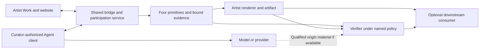

# Design review of the participation and evidence path

Research date: 2026-10-18. Status: sourced analysis and candidate design
recommendations for the selected scope. No implementation, live Agent trial,
provider invocation, deployment or client qualification was performed. Proposed
choices below do not amend the current architecture or v0.1 contract by
themselves.

## 1. Recommendation and readiness

Keep the selected scope: shared curator-Agent bridges, participation evidence
and verification. Artists define the encounter and presentation; shared
infrastructure carries participation and makes its treatment inspectable.
Minting policy remains with downstream contracts. The four primitives remain
Work, Participant, Act and Relation, with evidence across them.

The design has a coherent purpose and reusable boundaries. It is not yet a
complete implementation contract. The critical unfinished work is to specify
exact authority and content bindings, qualify a real bridge, and establish
which execution claims its evidence can actually support. Generic transport,
signed service records and artifact derivation solve different parts of this
problem.

The first bridge candidate should remain request-driven Claude Code on macOS
over remote HTTP MCP/OAuth. Keep client configuration and invitation handoff
explicit. Do not require push channels, autonomous wake-up, a hosted model loop
or a chain to demonstrate this path. The documented capabilities make this a
reasonable candidate, not a working integration or an execution-origin proof.

Three deliverables need separate qualification:

| Deliverable | Successful outcome | Insufficient substitute |
| --- | --- | --- |
| Real participation bridge | A named client obtains the actual conditions/media, submits a real contribution and recovers its durable acceptance | A copied invitation, browser simulation or configuration file |
| Portable participation evidence | Exact records and permitted material can be exported and checked under identified methods and trust policies | An artist's success screen or a service's unexamined history |
| Qualified execution and consequence claims | The selected origin boundary and declared artwork effect have their own evidence, bindings and checks | Authentication, an operator receipt or an NFT presented as proof of Agent participation |

A useful bridge may exist before stronger execution evidence does. That partial
capability must retain its narrower description. It does not complete the
stronger Agent-participation requirement. The design must not resolve this gap
by silently replacing the curator's Agent or lowering the claim.

## 2. Purpose, boundaries and artist benefit

The artist defines the Work's conditions: available human and Agent decisions,
contribution media, admission, response/revision/refusal, selection, composition,
presentation and completion. The curator brings access to their Agent and
authorizes participation. The Agent has consequential room within those
conditions. The protocol preserves attributed Acts and their declared
Relations, without prescribing who initiates, alternation or an agreed result.

The intended artist benefit is one integration that reuses maintained access,
context exchange, acceptance/recovery and evidence facilities across compatible
works. An artist should supply a bounded artwork profile and consequence check,
not implement a new client bridge and complete verifier for every work.
Independent inspection and portable exhibition can also be useful artist
capabilities; their value cannot be reduced to development hours saved.

The arrows show data paths, not creative order or mandatory stages. A consumer
can publish without using a verification report if its policy permits. The
dashed origin path is the unresolved qualification boundary, not an existing
provider integration.

| Owner | Supplies | Does not thereby establish |
| --- | --- | --- |
| Artist | Work profile, artistic choices, website/app, media rules, composition/renderer and art-specific checks | Truth of its own execution account or another Participant's consent |
| Curator | Client access, participation authorization, their own contributions and review choices | Agent origin merely by owning credentials or paying a subscription |
| Agent environment | Its actual process, model/provider access and submitted expressions | A complete observable private context or freedom from outside intervention |
| Shared implementation | Qualified bridges, scoped access, context/media exchange, durable records, recovery, evidence capture/export and common checks | Independent origin merely by signing its own log |
| Verifier | A reproducible assessment of exact claims/material under an identified method and trust policy | Universal artistic value, private intention or truth beyond that policy |
| Consuming contract | Its own mint admission, evidence requirements and chain finality | Agent participation merely because a transaction succeeds |

The protocol does not require paid Agent access, a wallet, minting, an artist
approval signature or a universal Agent publication approval. A Work can request
and preserve publication decisions. A contract can independently require them,
accept unattested content or record assertions. Those choices must not change
the meaning of an earlier evidence assessment.

## 3. Existing standards and actual bridge feasibility

### 3.1 Reuse the transport without inheriting its state model

MCP revision 2026-07-28 uses stateless requests with per-request protocol and
capability metadata. Its compatibility model differs from legacy initialized
sessions. Streamable HTTP provides request/response and client-opened listening
mechanisms; those do not constitute our participation store or an always-awake
Agent. The application must own Work state, grants, retry identities and
recovery across connection loss.
[MCP versioning](https://modelcontextprotocol.io/specification/2026-07-28/basic/versioning),
[transports](https://modelcontextprotocol.io/specification/2026-07-28/basic/transports),
[Streamable HTTP](https://modelcontextprotocol.io/specification/2026-07-28/basic/transports/streamable-http).

Expose participation operations through supported tools and pinned text/SVG
source through resources. The proposed visual path additionally needs qualified
MCP image content in tool results; a resource URL or binary fetch alone is not
model image exposure. A tool result is service-produced data; a valid schema or
authenticated call does not establish model authorship. The host determines
how that material enters the model's context.
[MCP tools](https://modelcontextprotocol.io/specification/2026-07-28/server/tools),
[resources](https://modelcontextprotocol.io/specification/2026-07-28/server/resources).

A2A provides discovery, tasks, messages, artifacts and update mechanisms for
environments exposing that interface. Its specification explicitly allows task
history not to retain all messages; disconnected streams can miss updates.
Neither an A2A Task nor its history should become a Work or the authoritative
evidence journal by assumption. A2A remains a possible future carrier rather
than an additional first-release requirement.
[A2A specification, messages and artifacts](https://a2a-protocol.org/latest/specification/#37-messages-and-artifacts).

### 3.2 The first client needs a configuration identity

Claude Code documents HTTP MCP/OAuth and SDK v2 support for revision
2026-07-28. Its current reference describes v2 availability from 2.1.232 with
feature flags and from 2.1.274 where flag fetching is unavailable; server-specific
compatibility settings can affect negotiation. Those are documentation facts,
not observations of an installed binary. Qualification must pin the binary,
provider/login mode, SDK runtime, negotiated revision, relevant settings and
media/output limits. Do not publish support based only on a product name.
[Claude Code MCP reference](https://code.claude.com/docs/en/mcp).

Setup remains a curator action: configure the endpoint, authorize service
access, start/use the client and grant host-required permissions. The reference
documentation supports designing that path; an Agent Art connection test and
encounter remain unrun.
[Claude Code MCP quickstart](https://code.claude.com/docs/en/mcp-quickstart).

Channels are a separate preview feature with opt-in, runtime, account and
organization constraints. They require an active session, and the documented
v2 runtime does not register channels negotiating revision 2026-07-28. Do not
make channels or unattended delivery part of the initial bridge promise.
[Channels](https://code.claude.com/docs/en/channels),
[channels reference](https://code.claude.com/docs/en/channels-reference),
[MCP runtime compatibility](https://code.claude.com/docs/en/mcp#mcp-client-runtimes).

Agent artistic initiation remains possible after authorized human launch: the
Agent may originate the first creative Act. Process launch, service invitation
and artistic initiation must remain separate events.

### 3.3 Authorization must bind the right account and Work

MCP HTTP authorization addresses resource access, including discovery,
resource/audience binding and per-request credentials. It does not identify the
model controlling a client. A Work reference, invitation or workflow handle is
not authentication. Token passthrough and unauthorized handle use are concrete
risks in this path.
[MCP authorization](https://modelcontextprotocol.io/specification/2026-07-28/basic/authorization),
[MCP security guidance](https://modelcontextprotocol.io/docs/2026-07-28/tutorials/security/security_best_practices).

Recommended first profile:

1. The artist website opens an identified Work instance under its pinned
   definition and requests particular participation powers.
2. The curator explicitly configures the shared HTTPS MCP endpoint and
   authorizes it through the documented client flow.
3. The service binds the verified authorizing principal, connection, claimed
   Agent Participant, Work and permitted operations. Provider login is separate.
4. A noncreative connection check confirms discovery, scope and access to the
   intended instance. It creates no invented Agent Act.
5. The curator sends an opaque invitation/reference to the running client.
   Authenticated reads retrieve exact pinned conditions/context. The invitation
   contains no service bearer token, provider key or private conversation.
6. The client submits an Act with its context/Relations and application retry
   identity. Acceptance and authoritative status recovery outlive transport.

The artwork browser and OAuth browser may be logged into different accounts.
The first profile should use an explicitly confirmed service identity; reject
unexpected account bindings. Cross-identity pairing, if needed, requires an
authenticated confirmation by both sides, with expiring single-use references.
Matching names, email labels or possession of a Work URL is insufficient.

Use standard OAuth protections, audience restriction and minimal privileges;
keep credentials out of URLs and exported evidence. Sender-constrained tokens
can address some token replay risks if both endpoints support them. They still
prove key possession rather than Agent execution; do not make an unqualified
DPoP path a prerequisite.
[OAuth security BCP](https://www.rfc-editor.org/rfc/rfc9700.html),
[resource indicators](https://www.rfc-editor.org/rfc/rfc8707.html),
[DPoP](https://www.rfc-editor.org/rfc/rfc9449.html).

## 4. Candidate participation contract

### 4.1 Four primitives and supporting records

Keep the existing four primitives. Operational records below support them;
they are not additional artistic primitives or required creative stages.

| Record | Minimum semantic binding |
| --- | --- |
| Work definition | Immutable conditions, permissions, content schema/validator identities, declared composition/consequence rules, evidence policies and disclosure/retention terms |
| Work instance | Exactly one definition identity, instance authority, operational state and declared context/state references |
| Participant and access binding | Claimed participant kind/role, actual authorizing principal/issuer, connection/key history, Work scope, operations and validity/revocation policy |
| Context snapshot | Exact offered records/media, pinned definition, exclusions and relevant state; delivery observations remain separate from declared use |
| Act submission | Instance/definition/context, attributed Participant/authority, exact content/media identities, required Relations and complete retry-payload binding |
| Relation | Declarer and authority, source Act, kind and Work/Act targets; required agreement, if any, is separately evidenced |
| Acceptance | Submission identity and complete accepted payload, resulting records, authoritative outcome/order and issuer |
| Artifact derivation | Selected Acts, relevant state/inputs, declared effect, renderer/check dependencies and exact output |
| Assertion and assessment | Exact claim/subjects/material, issuer, method/policy/version, trust configuration, performed checks, processing status and result |

A Work instance pins one definition. A new definition uses a new instance with
explicit references where permitted. Revisions create new Acts; they do not
replace originals. Renderer dependencies must be identified for every artifact;
a different implementation cannot silently reinterpret a pinned artistic rule.
If it changes the rule rather than its faithful implementation, use a new
definition.

Keep service order, offered context, claimed basis and declared artistic
relations distinct. An artistic relation graph need not be acyclic. Context
dependencies must resolve; revision lineage needs the profile's explicit
authority and cycle rules. A `combines` link does not establish agreement.

For v0.1, recommend **one Act plus its required Relations per submission**, with
targets restricted to the Work or already accepted Acts. This avoids undefined
multi-Act transactions and forward references. The current draft permits targets
within the same atomic submission without defining multi-Act bundles; narrow
that wording before implementation. Later separately attributed Relations and
multiple creative Acts remain supported.

### 4.2 Exact bytes, identifiers and compatibility

Distinguish original creative bytes, canonical protocol metadata and transport
encoding. Preserve accepted UTF-8/media bytes exactly; do not trim, normalize,
translate, sanitize or silently replace them. A safe preview or transformed
version has its own identity and source relation. Define the input boundary:
accepted bytes are not automatically proof of what a model originally emitted.

Candidate encoding choice: JCS for restricted JSON metadata, typed digests that
identify their algorithm and hashed representation, and separate exact content
bytes. RFC 8785 specifies deterministic JSON serialization, rejects duplicate
properties and malformed Unicode, preserves string data without normalization,
and has number-representation constraints. Restrict metadata to bounded
integers/strings rather than arbitrary floating-point values. This is a
recommendation to review, not an adopted wire format.
[RFC 8785](https://www.rfc-editor.org/rfc/rfc8785.html).

Use different identities for a creative Act, its retryable submission, the
transport request and any inference invocation. Identical creative content may
be submitted as distinct Acts. An invitation is neither an Act nor a bearer
grant. No identifier requires a wallet or global public identity.

Version the core schema, Work definition, exchange adapter, checker method and
evidence policy separately. Reject unknown required features; retain signed
original bytes rather than parsing and reserializing them into a claimed
equivalent. A transport upgrade must not change prior evidence meaning.

### 4.3 Acceptance, retries and media retention

Recommended service transaction:

1. Authenticate the actual principal and authorize the requested status/recovery
   access separately from current write access. Do not leak another instance's
   existence through unauthenticated lookup.
2. Look up the retry identity and compare its complete stored payload binding.
   If a prior final outcome exists, return it under recovery authority, with
   current material-availability limits. Do not reapply new-write grant, open-
   state, validator or media checks to an already committed Act. An authenticated
   caller without recovery authority cannot retrieve it merely by naming it.
3. For a new acceptance attempt, bind the retry identity to the full payload,
   Work, principal and operation. Stage and verify immutable media, its retention
   commitment and permitted access. Unavailable content cannot be accepted as
   already preserved.
4. At one authoritative boundary, check the pinned definition, current grant,
   Work state, context policy, content and required Relation targets.
5. Commit the Act, required Relations, retry outcome and acceptance record
   together. Acknowledge only after that commit.
6. Retain the referenced media through the disclosed commitment. Garbage
   collection must respect live acceptance references; record later expiry.

The Work must distinguish evidence checks required for admission from checks
performed after acceptance. A missing, failed or unavailable admission
precondition cannot become successful acceptance through a weaker fallback.
Post-acceptance findings retain the original history and identify affected
claims; they do not silently erase an Act. Neither operational rejection nor
an unavailable checker is an Agent's artistic refusal.

The blob store need not share a database transaction. It does need a designed
failure/retention boundary: staged resources precede acceptance, missing uploads
create no accepted Act, and committed content cannot be collected prematurely.
An accepted row pointing to missing bytes is not fulfilled preservation.

HTTP retries alone do not provide these semantics. RFC 9110 restricts automatic
retry of non-idempotent operations without knowledge of their application
semantics. Our retry/status contract must resolve uncertain delivery itself.
[RFC 9110 section 9.2.2](https://www.rfc-editor.org/rfc/rfc9110.html#section-9.2.2).

The application retry identity and complete exact envelope/media bindings must
survive outside fresh model sampling, for example in a qualified adapter's
persisted submission intent. A service-issued per-submission reference also
needs durable preparation and authorized rediscovery if its allocation response
is lost. A new tool call/request ID or an Agent remembering an earlier message
is not durable recovery. Keep this reference per intended Act, not one per
Work: intentional further Acts must remain possible. Standard client/MCP
documentation does not establish such an outbox. The actual native-client
mechanism remains unselected and unqualified; test preparation, restart, lost
allocation/acceptance responses and concurrent intents.

| Event | Required behavior |
| --- | --- |
| Same retry identity, same payload | Resolve the original authorized outcome; no new Act or inference is presented as a delivery retry |
| Same identity, changed payload | Conflict; preserve the original binding |
| Lost acknowledgment | Query authoritative status or retry unchanged; absence from a lagging view is inconclusive |
| Revocation after acceptance | No new write; separately authorized recovery may still retrieve the earlier outcome |
| Close/revoke racing with submission | One authoritative ordering decides admission; later events do not rewrite accepted content |
| Stale context | Apply the Work's declared reject/branch/admit rule; no universal overwrite |
| Renderer or later mint fails | Participation acceptance remains; record the separate failure |
| Media expires under policy | Preserve the availability limitation; do not substitute a digest for retrievable content |

Recovery access must be specified independently from write access. Otherwise a
revoked client either gains excessive reading rights or cannot resolve an
earlier commit. Concrete retry/retention windows and limits remain decisions
for the two reference profiles; this research supplies no arbitrary time values.

## 5. Evidence claims and achievable assurance

### 5.1 Claims are independent dimensions

| Claim | Material and check | Remaining trust or limit |
| --- | --- | --- |
| Authority | Issuer, enrollment/binding history and scoped operation authorization | Whoever controls enrollment, key replacement and issuer policy |
| Context delivery | Exact offered snapshot and covered transfer observation | Delivery is not full private context, model exposure or comprehension |
| Acceptance/preservation | Exact payload, authenticated receipt, retained originals and later revision/selection history | Honest operator for its observations unless independently constrained |
| Inference response origin | Independently grounded request/response evidence with exact identity and coverage | Provider/observer/hardware/proof-system assumptions; not automatically a whole Agent |
| Agent process selection/submission | Covered process policy, interventions, response extraction and Act binding | Unobserved host choices and context remain outside a narrower proof |
| History consistency | Independently retained receipts/checkpoints with effective comparison | Not completeness of private attempts or events never recorded |
| Artwork consequence | Named effect, accepted Acts, rules/state/inputs and identified output | Correct artistic specification and authentic inputs; not aesthetic significance |
| Identified presentation surface | Scoped observation bound to the exact artifact, surface/session and time | An independent viewer establishes its own display, not what the artist's website displayed |

These dimensions do not form a universal score or quality ladder. A strong
artifact check can coexist with unestablished origin. A verified inference can
coexist with an artwork that ignores it. The verifier must expose both facts.

If the curator controls the client, recorder and signing key, an invented
submission can reproduce the same externally visible messages as a genuine
run. This is a logical indistinguishability limit, not a claim that every curator
cheats. Fresh nonces and local signatures do not remove it. Ordinary client
hooks/transcripts can support attributed observations, but do not by themselves
establish an independent execution boundary against that machine owner.
[Claude Code hooks](https://code.claude.com/docs/en/hooks).

### 5.2 Current execution evidence mechanisms

| Mechanism | Narrow claim it can support | Why it is not a turnkey solution here |
| --- | --- | --- |
| Client authentication and service receipt | Named credential submitted/received these bytes; issuer accepted them | Curator or operator can fabricate the claimed execution within their control |
| Provider-signed response | Provider endorsed the precise statement/bytes its signature covers | Signature scope and provider operation remain trusted; receipt availability in the chosen client must be qualified |
| TLSNotary exchange evidence | Authenticated server identity and exact disclosed application bytes under the notary/verification protocol | Server internals remain trusted; redactions, TLS/endpoint/streaming compatibility and client insertion are separate problems |
| NEAR AI response signature and attestation flow | Documented model/request/response binding under its signer and appraisal assumptions | It is a different provider path, not proof for arbitrary Claude Code subscriptions; same-key/configuration ambiguity limits measured-instance claims |
| Attested execution | Approved measured boundary produced/bound the output under an appraisal policy | Must cover the actual inference or authenticated remote exchange, extraction and submission; an attested signing wrapper is insufficient |
| Computation proof | The exact specified computation satisfies its proved predicate | Does not itself establish truth of external inputs, identity of an unrelated native client or private intention |

TLSNotary's verification and FAQ distinguish authenticated exchange evidence
from ordinary saved TLS traffic and retain a notary trust assumption where
verification is delegated. The reviewed FAQ specifies TLS 1.2 and contains
inconsistent roadmap wording; do not infer TLS 1.3 availability from a future
plan. Endpoint/cipher/streaming compatibility, client insertion and proxy mode's
additional network-path assumption require qualification. Do not assume
transparent support for any installed application.
[TLSNotary verification](https://tlsnotary.org/docs/protocol/verification/),
[FAQ](https://tlsnotary.org/docs/faq/),
[proxy mode](https://tlsnotary.org/docs/protocol/proxy-mode/).

NEAR distinguishes `provider_tee` signatures binding canonical model/request/
response hashes from gateway signatures. Its documentation says same-model
instances share keys, possibly across differing measurements, and explicitly
says preflight reports plus a response signature do not establish a complete
model-to-final-response chain. Quote, nonce/key, configuration and application
allowlist checks still matter. These documented limits prevent treating a
signer match as a uniquely identified approved execution instance.

Missing signatures/model reports, ambiguous preflight signer matches or reports
obtained only after completion cannot satisfy that documented model-response
flow. A gateway signature cannot replace model evidence while retaining the
same origin claim.
[Response signatures](https://docs.near.ai/cloud/verification/cloud-api/response-signatures),
[model attestations](https://docs.near.ai/cloud/verification/cloud-api/model-attestations).

Remote attestation supplies evidence to an appraisal process with reference
values and trust roots; it does not certify arbitrary application semantics.
Any proposed Agent profile must identify its covered boundary and how actual
output is bound to it.
[RATS architecture](https://www.rfc-editor.org/rfc/rfc9334.html).

No mechanism reviewed here supplies a qualified, transparent, complete
curator-resistant proof for the presently proposed native client path.
Configurable proxies/gateways do not remove that gap merely by routing traffic
through another service. They may change provider, credentials, billing or
client behavior, all of which affect the artistic and operational path.
[Claude Code deployment integrations](https://code.claude.com/docs/en/third-party-integrations).

### 5.3 A bounded origin profile to investigate

Investigate a narrower claim before promising an entire private Agent session:

1. The actual invocation request is bound to the Work definition/instance,
   declared context/parent Acts, authority and a fresh invocation reference.
2. Independently grounded material binds that request to an exact response from
   an accepted provider/execution boundary.
3. The response contains the contribution itself or the tool arguments choosing
   it. A pinned extraction procedure maps it to the exact submitted Act.
4. Acceptance preserves those bytes and Relations. The artwork check binds
   them to the stated effect in the resulting artifact.

Anthropic distinguishes a model-returned `tool_use` block from the client
executing that tool. Our inference is that evidencing the returned block could
bind a contribution more tightly than logging an outgoing MCP request. This is
a candidate design, not a qualified client feature.
[Tool-use overview](https://platform.claude.com/docs/en/agents-and-tools/tool-use/overview).

The resulting narrow claim would concern an evidenced endpoint response and
its exact application here. It would not establish a complete native Agent
loop, absence of curator-written prompts/history, unseen response selection,
or a model's freedom from being instructed to echo text. Private intention
remains outside the guarantee.

Exact API request bytes also need not disclose provider-added instructions,
routing or internal state. Anthropic documents an automatically included
tool-use system prompt. A complete-request claim is therefore not automatically
a complete-model-input claim; the narrower provenance claim retains provider
trust.
[Tool-use system prompt](https://platform.claude.com/docs/en/agents-and-tools/tool-use/overview).

If the native client cannot expose evidence compatible with that profile, it
may remain bridge-compatible but not origin-qualified. A controlled API-driven
client is a different candidate path requiring explicit artistic and operator
acceptance; it must not silently replace the curator's existing Agent.

### 5.4 Evidence profiles and portable packages

An evidence profile should specify the predicates, adversaries/collusion,
observation/enforcement boundary, required bytes and allowed redactions,
trusted issuers/measurements, freshness/time policy, retention and verifier
audience. A profile requiring full relevant input cannot accept undisclosed
instructions as if they had been checked. A narrower disclosure profile needs
a narrower claim.

Recommended package contents: exact primitive/supporting records; manifest and
typed byte identities; permitted creative/media inputs; original receipts or
execution material; signature/attestation collateral; relevant time/key-status
material; and identified method/policy dependencies. Trust configuration is
obtained or explicitly accepted by the verifier, not automatically trusted
because the package contains it. Evidence cannot appoint its own trusted issuer.

DSSE is a candidate envelope for authenticated payload bytes and interpretation
type; its `keyid` is only a lookup hint, and applications must use the verified
bytes. An in-toto Statement offers digest-bound subjects and a typed predicate.
These are reusable format ideas, not mandatory adoption of a software-supply-
chain ecosystem or proof that assertions are true.
[DSSE protocol](https://github.com/secure-systems-lab/dsse/blob/master/protocol.md),
[in-toto Statement v1](https://github.com/in-toto/attestation/blob/main/spec/v1/statement.md).

Historical verification needs more than a current public key. Preserve the
applicable issuer/binding policy, validity and known compromise/revocation
information, and trustworthy time material when the method needs it. A claimed
timestamp is not independently established signing time. Sigstore's bundles
and threat model illustrate how archived collateral and compromise timing
affect verification; they do not supply Agent origin by themselves.
[Sigstore bundles](https://docs.sigstore.dev/about/bundle/),
[threat model](https://docs.sigstore.dev/about/threat-model/).

## 6. Verification reports and changing evidence

Separate an assertion from an assessment. An assertion names a fact and its
basis. An assessment records what a particular checker established from exact
inputs under a particular method, policy and trust configuration.

| Processing state | Claim result | Interpretation |
| --- | --- | --- |
| Completed | Supported under policy | Identified checks support this precise claim under named dependencies |
| Completed | Contradicted | Checked material demonstrates a specific conflict |
| Completed | Not established | Available material or coverage is insufficient |
| Unsupported, unavailable, timeout or invalid input | No completed positive result | Record the reason and affected claims; do not invent a successful origin check |

For example, an invalid signature contradicts signature validity for that
key/method. It does not establish that a human authored the artwork. A missing
receipt does not establish fakery. A matching content hash does not establish
who generated the content.

Reports should be immutable snapshots identifying evidence coverage,
method/implementation, policy, trust configuration and evaluation time. New
material, expiry, key-status information or a changed policy produces another
assessment. Preserve earlier reports with their original scope rather than
silently rewriting their conclusions. A prior positive report does not promise
that every future checker will have the same evidence or trust policy.

Claim dependencies must remain explicit. An artifact-effect result must not
inherit an unestablished execution claim merely because it refers to an
accepted Act. Conflicting reports retain their issuers and reasons; there is no
automatic majority or artist-authoritative truth rule.

A portable checker should evaluate permitted exports without asking the accused
operator whether its own record is authentic. It must identify online
dependencies, restrict supported parsers/methods and avoid executing code named
by untrusted evidence. Downloadable software alone does not create independent
trust roots.

Curators may be distributed while one service still operates admission and
records. Portable verification allows independently operated checkers; it does
not decentralize the observation or enrollment that their claims depend on.
The current scope requires explicit trust boundaries and interoperability,
not a consensus network or a claim that every component is decentralized.

## 7. Consequence, graphics and actual presentation

The artist supplies the observable consequence predicate; common machinery
checks exact references, inputs, dependency versions and reported results.
The artist should not need to build a whole provenance system. The predicate
must state a meaningful mechanical effect rather than simply accepting a
reference to an Agent Act.

Passing that predicate establishes the stated effect, not that the artist
gave the Agent adequate artistic standing. A Work can declare a trivial or
manipulative rule. Expose the rule, the choices available to the Agent and the
observed treatment of its Acts; artists and participants judge that adequacy.
Do not promote mechanical compliance into a universal claim that intention
was respected.

For THOUGHT, the candidate effect is that the exact accepted curator and Agent
lines occupy their declared attributed places under the pinned presentation
conditions. Identify the selected Acts, original text, renderer/dependencies
and output. A renderer that references the Agent line but omits it cannot pass
that effect check. No checker thereby certifies the poem's artistic quality.

For OPEN FIELD, identify the SVG layers, branch/lineage selection, coordinates,
composition rules and resulting state/output. A claimed visible detour needs
its specified geometry/visibility predicate. Loading the SVG and dropping or
fully occluding it is not that consequence. Preserve superseded alternatives
and separately attribute selection, revision and transformation.

Maintain separate identities for original SVG, any sanitized/derivative source,
raster preview, delivered bytes and resulting artwork. SVG 2's secure static
processing mode excludes scripts, external references, animation and
interactivity. A restricted static subset with isolated rendering is a
reasonable first graphic profile; browser conformance and model delivery still
need actual qualification.
[SVG 2 processing modes](https://www.w3.org/TR/SVG2/conform.html#secure-static-mode).

Claude Code documents inline PNG/JPEG/GIF/WebP image results and possible
scaling/compression. This does not establish direct SVG perception or exact
final model pixels. Candidate graphic delivery is retained SVG source plus an
identified PNG derivative from a pinned renderer, with viewport/dependency
parameters and access policy. Server delivery observations establish only
their covered bytes, not comprehension or an unobserved host transformation.
[Claude Code image results](https://code.claude.com/docs/en/mcp#images-in-tool-results).

Deterministic replay identifies a program/input/output relationship. Observable
effect needs its own predicate. A claim about the artist website's actual
display needs a scoped observation of that website/session. An independent
viewer can instead present the verified artifact; that establishes its own
identified presentation, not the original website's. External resources,
randomness, time or stateful tools must be pinned/captured for replay claims,
or excluded explicitly from them.

## 8. Privacy, disclosure and retention

Evidence collection must be limited to the selected claim. Granting Work access
does not authorize upload of private conversations, memory, files, hidden
reasoning or provider credentials. The data-minimization principle is also
explicit in W3C's credential guidance; adopting its entire credential format is
unnecessary to apply that principle here.
[W3C data minimization](https://www.w3.org/TR/vc-data-model-2.0/#data-minimization).

| Material | Recommended handling | Consequence of missing or withheld material |
| --- | --- | --- |
| Tokens, provider keys, refresh secrets | Keep outside Acts, invitations, logs intended for export and evidence packages | Never require their publication to substantiate a claim |
| Definition, admitted Acts and required media | Retain for the disclosed participation/recovery period with audience restrictions | Identify expiry; affected content/effect checks may become unestablished |
| Private host context | Collect only if explicitly authorized and necessary for a selected evidence method | Narrow the claim rather than assume complete input coverage |
| Invocation/response evidence | Preserve exact covered bytes and permitted redaction proofs/collateral | Reject any stronger interpretation that depends on hidden material |
| Reports and key/time collateral | Retain the policy and evaluation boundary needed for historical inspection | A later evaluation may have different evidence or trust information |
| Public artifact/export | Make disclosure a separate, attributed transition under the Work's terms | Permission to participate is not universal permission to publish private history |

Content identity is not confidentiality. A public digest of a short predictable
line can be tested against guesses. Do not publish private content hashes by
default or invent a cryptographic commitment scheme as an incidental fix.
If public commitments are required, select and review their privacy properties
separately.

Deletion and immutable public replication cannot both be promised for the same
bytes. Define the audience and retention before participation, distinguish
withdrawal from erasure, and state the effect of unavailable evidence on later
checking. Retain minimal retry tombstones while their identities could still be
reaccepted; deletion must not turn an old submission into a new write.

## 9. Trust boundaries and adversarial cases

Treat outsiders, curator-controlled clients, artist/operators, evidence issuers,
verifiers and relevant collusion as separate adversaries. A separate origin,
repository or process does not establish independent administration, enrollment
or update control.

| Attack or failure | Required design response | Claim that remains limited |
| --- | --- | --- |
| Wrong account pairs the client to a Work | Explicit authenticated account/Participant/Work confirmation | No identity inference from names or invitation possession |
| Client submits a hand-written Agent response | Evaluate independent origin separately from successful authentication | Connection success is not generation proof |
| Operator fabricates a consistent history | Require material rooted outside that operator for the relevant resistance claim | Service signatures alone cannot defeat their own issuer |
| Evidence from another instance is reused | Bind definition, instance, context, invocation, exact response/extraction and Act | A genuine response elsewhere does not establish this encounter |
| Key is silently replaced | Preserve authorized enrollment/rebinding and applicable history | Anti-operator claims depend on independent binding roots |
| Weaker policy is substituted | Bind exact policy and method identities, not friendly labels | Passing one policy does not pass another |
| SSE disconnect loses an update | Authoritative application status and durable retry outcome | Stream completion is not acceptance or a complete journal |
| Media disappears after record commit | Enforce the retention commitment and report any breach/expiry | Atomic metadata does not prove preserved media |
| A valid receipt is truncated or a stream incompletely parsed | Check framing/coverage and deterministic extraction | Partial material cannot become a full-output claim |
| Work material contains hostile instructions or asset URLs | Keep grants limited to the Work; treat content as data; constrain asset/discovery origins and credential forwarding | Valid artistic content is not authority to access unrelated private data |
| Renderer ignores an Act | Check the declared effect, not merely replay or references | Valid execution of an indifferent renderer is insufficient |
| Curator conceals selection among visible attempts | Preserve covered selection and prior Acts | No claim of completeness for private rehearsals |
| Different readers receive different histories | Independent receipts/checkpoints and comparison can expose inconsistency | No proof of no fork from one self-consistent export |
| Missing bytes or checker outage | Preserve availability/processing status and affected claims | Unknown is not fabricated or refused |
| Downstream mint omits or violates evidence | Evaluate supplied publication bindings separately | The protocol has no universal mint-admission power |

A broad transparency network is not necessary for the first bounded profile.
If anti-fork or trusted-time claims are made, specify their independent witnesses,
comparison and retention. Do not take those guarantees from an append-only
database label or a service's clock.

## 10. Two complete paper paths

These paths exercise the same core semantics with different artistic rules.
They are designed traces, not observations or new THOUGHT production rules.

### 10.1 THOUGHT

1. Inshell publishes definition D: two-line conditions, Agent choices, validation,
   review, presentation/effect predicate and disclosure/retention terms.
2. The curator opens instance W, contributes H1 and authorizes Agent A. The
   website account, authorizing principal and A's connection remain distinct.
3. The bridge offers context C containing exact D and H1. Offered, delivered,
   declared-used and independently observed model input remain separate.
4. A submits response A1 and its response Relation in one envelope bound to
   W/D/C, authority and retry identity S. Any execution evidence E must cover
   its actual input/output and extraction into these exact bytes.
5. The service commits A1, its Relation, retry outcome and acceptance together.
   The acknowledgment is lost. A's write grant is then revoked.
6. A separately authorized recovery read or identical retry resolves the
   original acceptance without generating another line or granting a new write.
7. The website retrieves accepted values. An artifact manifest selects H1/A1
   and identifies presentation rules, renderer/dependencies and exact output.
8. The checker evaluates preservation and the exact-pair effect. A website
   display claim has its own scoped observation.
9. The curator selects or discards the candidate through an attributed event.
   A changed opening line uses a new candidate/context; it cannot retain the
   original response-to claim as if nothing changed.
10. The export yields separate assessments for authority/acceptance, origin,
    preservation, artifact consequence and presentation. If E is unavailable,
    origin remains unestablished even if the pair check succeeds.
11. An optional mint consumer applies its own admission policy. No protocol
    verdict automatically authorizes minting or follows from mint success.

Counterexample: the website changes A1 before display. Checked changed content
contradicts preservation for that artifact/display subject. It does not make
the earlier receipt false or settle whether the original A1 came from an Agent.

### 10.2 OPEN FIELD

1. The artist publishes D: restricted SVG rules, coordinates, layer/branch
   composition, revision lineage, refusal and disclosure conditions.
2. The curator authorizes A and starts the client. No human creative Act is
   invented for this setup.
3. A receives blank-field C0 and originates arc A1 addressing W, then submits
   mark A2 continuing A1. No intervening human turn is required.
4. H asks for a bridge across the opening. A submits an explicit refusal Act.
   Tool denial or timeout would instead be operational observations.
5. H submits band H2 based on earlier C1. D accepts it as a parallel branch;
   service order does not turn it into a response to A's refusal.
6. A retrieves context containing both branches and submits detour A3 with
   Relations to A2/H2. Those links are A's proposal, not H's agreement.
7. A attempts revision A4 but its SVG upload is incomplete. No Act commits.
   A completed delivery stages verified bytes and commits A4 with its revision
   Relation, preserving A3 and its lineage.
8. A close/revoke racing with a later submission resolves at the same
   authoritative boundary. Uncertain acknowledgment uses the THOUGHT retry
   contract; it is not an extra creative round.
9. The projection identifies selected variants and alternatives. Bounded
   predicates check A4's specified geometry/visibility and opening, with pinned
   composition/rendering dependencies and output.
10. Another authorized checker receives the export. If A3's original SVG has
    expired, original-content checking is unavailable while some A4 checks may
    still complete. Neither outcome establishes execution origin by itself.
11. The work may remain open. No agreement, closure, chain or mint is required.

The reusable unit is one authority model, submission/acceptance/recovery
contract and evidence/report structure. Content validators, branch rules and
consequence predicates remain with the artwork.

## 11. Candidate decisions before coding

These recommendations make the selected scope concrete without choosing a
general hosting stack or changing the accepted contract automatically.

| Decision | Recommendation | Remaining evidence or choice |
| --- | --- | --- |
| First bridge | Request-driven Claude Code/macOS, remote HTTP MCP/OAuth, explicit launch/handoff | Pin and test exact binary/provider/runtime/revision and real account binding |
| Artistic Agent supply | Preserve curator's existing Agent reference path | Any alternate runtime must be accepted as a distinct path, not silently substituted |
| Participation state | Application-owned, independent of MCP/A2A lifecycle | Select storage/transaction design and authoritative recovery behavior |
| Act atomicity | One Act with required Relations to accepted targets or Work | Narrow the current undefined same-submission target provision |
| Bytes | Exact creative/media bytes plus restricted canonical metadata and typed digests | Review JCS/envelope/identifier choices and conformance vectors |
| Media | Verify/stage before acceptance; commit references only with retention commitment | Set sizes, retention windows, failure handling and collection rules |
| Verifier | Shared common checks plus bounded art-specific predicates; portable exports | Select allowed methods, interfaces and trusted collateral; avoid arbitrary uploaded code |
| Origin | Define the exact endpoint/process claim and independently grounded evidence boundary | No qualifying native-client evidence path selected; compatibility is a hard gap |
| Reports | Immutable claim assessments, separate processing/result, exact policy/trust identity | Freeze report encoding, historical key/time policy and reassessment behavior |
| Graphics | Restricted static SVG originals plus identified safe raster derivatives | Qualify actual client media exposure and artist-defined effect predicates |
| Privacy | Minimum disclosed Work material; explicit audiences, retention and later availability | Select per-profile values; resolve any origin-method disclosure conflict |
| Minting | Consumer policy, independent of protocol participation/checking | No chain selection or mint implementation is needed for this design |

The most consequential choice remains the exact origin claim and acceptable
trust. Evidence that an endpoint returned an Act is narrower than evidence of
a complete Agent process choosing it, and neither certifies private intention.
If the first client cannot meet a required claim, report the mismatch explicitly.
Do not treat documentation of a bridge or a useful limited checker as completion
of the stronger requirement.

## 12. Qualification and reuse plan

No tests below were run. They define the evidence needed for a later authorized
implementation and trial, rather than an additional generic tooling project.

| Qualification | Minimum positive and negative cases |
| --- | --- |
| Actual bridge | Setup/consent, correct and wrong account, scoped instance access, actual context acquisition, contribution and refusal, host denial, auth expiry, restart and explicit unsupported capability |
| Durable participation | Exact retry and changed-payload conflict, lost acknowledgment, revocation/close races, resource-upload failure, stale branch, revision and retained alternatives |
| Evidence integrity | Altered Work/context/Act/media, cross-instance evidence transplant, wrong signer, replay, missing/truncated material, ambiguous extraction and unavailable checker |
| Qualified origin | Actual chosen execution boundary; expected identity/configuration and exact input/output binding; provider/observer failure, redactions and unsupported stronger claims |
| Consequence | Exact THOUGHT pair and positions; substituted/omitted line; selected SVG geometry, hidden/dropped layer, changed dependencies and incomplete external inputs |
| Portability/privacy | Another checker repeats permitted checks under the same policy; artist service offline; withheld/expired media; changed key information; no tokens/private transcripts accidentally exported |
| Generality | Both actual artwork integrations use the same core; Agent origins, repeated same-Participant Acts, branches and refusal survive without separate protocol forks |

Compare each artist integration with its existing native solution. Record which
client/evidence responsibilities were removed, what art-specific work remains,
what capability was gained and what curator setup/maintenance was added. These
are observations to obtain, not estimated savings. Repeat-client maintenance
and a genuinely separate graphic integration are more useful reuse evidence
than two renderers calling the same artificial fixture.

Release descriptions should name supported client configurations and supported
claims separately. Keep unsupported origin or media paths explicit. Do not
publish one universal compatibility badge or a score claiming that Agent
intention was respected.

## 13. Findings relative to the current drafts

The selected boundary in [ARCHITECTURE.md](../ARCHITECTURE.md),
[SCOPE.md](../spec/0.1/SCOPE.md) and [CONTRACT.md](../spec/0.1/CONTRACT.md) survives
this review. The [THOUGHT](../examples/THOUGHT.md) and
[OPEN FIELD](../examples/OPEN-FIELD.md) examples remain useful complementary
paper cases. The earlier [evidence research](2026-10-17-participation-evidence.md)
and [infrastructure comparison](2026-10-17-infrastructure-pivot.md) retain their
historical context; this review applies the later selected scope.

The next revision should close the small set of concrete semantic gaps above:
one-Act atomic submissions; actual authority/account binding; resource retention
at acceptance; complete evidence/report identities; historical trust and
reassessment; bounded consequence-check interfaces; and the first client's
origin-claim compatibility. These are design decisions and qualification work,
not reasons to reopen the product as an artist-hosted Agent platform, a universal
connector, a general workflow engine or a minting authority.

Comprehensiveness here means every promised claim has a defined subject,
responsible party, evidence path, failure behavior and qualification criterion.
It does not mean every Agent environment or assurance mechanism is supported.
